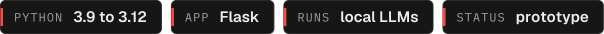

<p align="center"><a href="https://adithyapoojary.is-a.dev"><picture><source media="(prefers-color-scheme: light)" srcset=".github/readme/banner-light.svg"></picture></a></p>
<p align="center"><picture><source media="(prefers-color-scheme: light)" srcset=".github/readme/badges-light.svg"></picture></p>

YT-Sentiment reads the comments under a YouTube video and tells you how the audience actually feels, with charts and a written breakdown from a local LLM. For creators and marketers who want more than a like count.

## Highlights

- **Paste a link, get a read.** Pulls the video's details and up to 100 top-level comments through the YouTube Data API.
- **Sentiment that knows the internet.** TextBlob scores each comment, then simple rules adjust for sarcasm cues (laughing and eye-roll emoji) and agreement words.
- **Local AI write-up.** A small Ollama model (`qwen2.5-coder:1.5b` by default) turns the numbers into themes, audience suggestions and a summary.
- **Charts and history.** A Flask web app draws the sentiment split and comment timeline, and keeps every past analysis in SQLite to browse later.
- **Markdown reports.** The command-line mode writes a full report per video to a `.md` file.

## How it works

1. You submit a YouTube URL in the web app (`app.py`) or at the prompt (`test.py`).
2. The YouTube Data API returns video metadata and comments.
3. Each comment gets a sentiment score, adjusted for sarcasm and agreement.
4. The aggregate goes to Ollama for a written analysis.
5. Results are saved to `youtube_analysis.db` and shown as charts, or written as a Markdown report in CLI mode.

## Quick start

Needs Python 3.9 to 3.12, [Ollama](https://ollama.com), and a YouTube Data API v3 key from a Google Cloud project.

```bash
git clone https://github.com/NullSecurity07/YT-Sentiment.git
cd YT-Sentiment
python3 -m venv venv && source venv/bin/activate
pip install -r requirements.txt matplotlib
ollama pull qwen2.5-coder:1.5b
echo 'YOUTUBE_API_KEY=your_key' > .env
python app.py
```

Open http://127.0.0.1:5000. For the command-line version with a Markdown report, run `python test.py` (it reads `YOUTUBE_API_KEY` from the environment, so `export` it first).

## Project layout

```
app.py        Flask app: analyze, history, video pages, charts
test.py       YouTube API, sentiment, Ollama, SQLite, Markdown reports (also a CLI)
templates/    HTML pages
```

## Status

Prototype. `matplotlib` is used for the charts but missing from `requirements.txt` (hence the extra install above), and `transformers` and `torch` are listed but not used yet. Next: tidy dependencies and rename `test.py` to something that says what it does.

## Built by

Built by [Adithya Poojary](https://adithyapoojary.is-a.dev), founder of ThreatScope. [More projects](https://adithyapoojary.is-a.dev/work/) · [LinkedIn](https://www.linkedin.com/in/adithyapoojary/)
